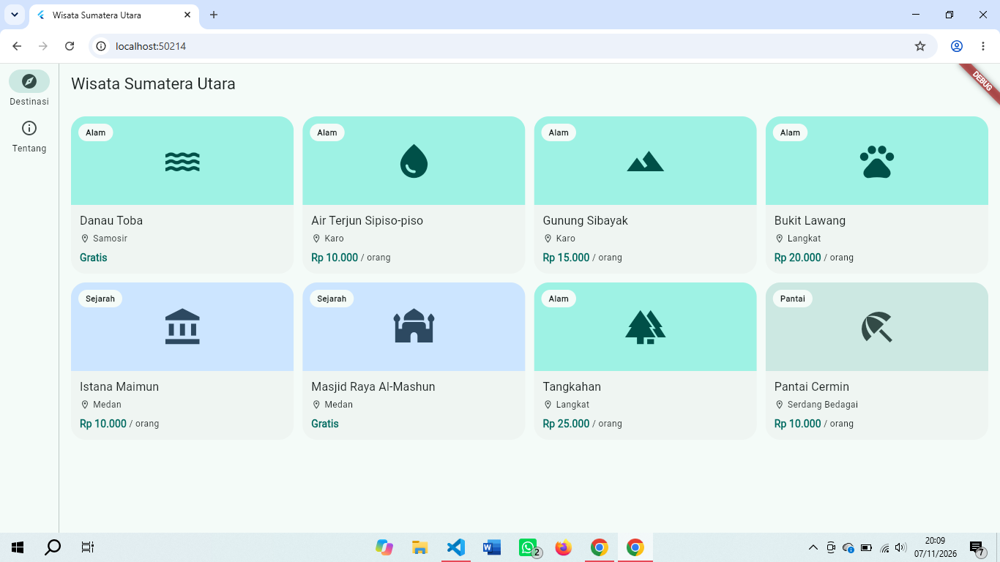
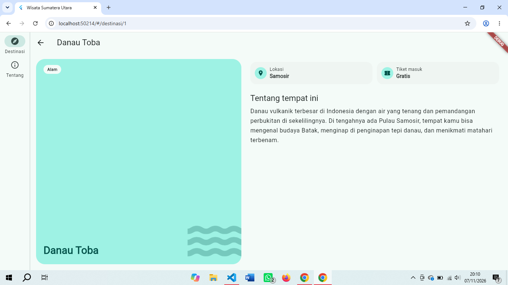
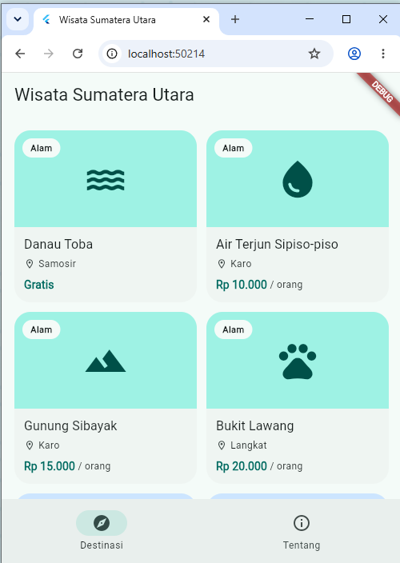
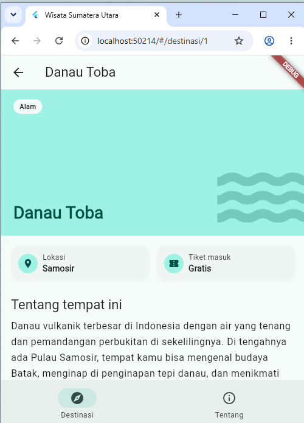

# pm-pertemuan-06-4241250005

Tugas Rutin 6 - Pemrograman Mobile: Wisata Sumatera Utara

- Nama: Nayla Anjani Nasution
- NIM: 4241250005
- Kelas: PSIK 24C

Aplikasi Flutter berisi katalog 8 destinasi wisata Sumatera Utara. Tampilannya menyesuaikan lebar layar: jumlah kolom grid, susunan halaman detail, dan menu navigasi berubah mengikuti ukuran jendela. Data destinasi dan harga tiket hanya contoh.

## Cara Menjalankan

```
flutter pub get
flutter run -d chrome
flutter test
```

Paket yang dipakai: `material_ui` dan `go_router`.

## Tangkapan Layar

Layar lebar (jendela penuh, sekitar 1366 dp): menu di samping (`NavigationRail`), grid 4 kolom, dan detail dua kolom.





Layar sempit (sekitar 500 dp): menu di bawah (`NavigationBar`), grid 2 kolom, dan detail satu kolom.





## Rute

| Rute | Halaman |
|---|---|
| `/` | `DaftarDestinasi` (grid) |
| `/destinasi/:id` | `DetailDestinasi` |
| `/tentang` | `Tentang` |

URL yang tidak dikenal dan `:id` yang tidak ada menampilkan halaman 404. Rute memakai `StatefulShellRoute.indexedStack` dengan dua cabang (daftar dan tentang), sehingga tiap cabang mengingat posisinya saat berpindah tab.

## Struktur Kode

| File | Isi |
|---|---|
| `lib/main.dart` | konfigurasi `go_router`, tema, dan `KerangkaNavigasi` (bar atau rail) |
| `lib/destinasi.dart` | model `Destinasi`, 8 data, extension `rupiah`, dan warna per kategori |
| `lib/halaman_daftar.dart` | grid dengan `LayoutBuilder` dan `KartuDestinasi` |
| `lib/halaman_detail.dart` | detail responsif, `Stack` sampul, dan halaman 404 |
| `lib/halaman_tentang.dart` | halaman tentang dengan `Stack` |
| `test/widget_test.dart` | satu widget test: membuka detail dari grid |

## Alasan Keputusan Responsif

**1. Bar atau rail memakai `MediaQuery` (batas 840 dp).**
Menu navigasi adalah bagian dari kerangka seluruh aplikasi, jadi keputusannya harus berdasarkan ukuran seluruh layar atau jendela, yaitu `MediaQuery.sizeOf(context).width`. Di bawah 840 dp dipakai `NavigationBar` di bawah supaya mudah dijangkau ibu jari, dan mulai 840 dp dipakai `NavigationRail` di samping karena ruang horizontal sudah luas. Angka 840 mengikuti kelas lebar `expanded` pada Material 3.

**2. Jumlah kolom grid memakai `LayoutBuilder` (batas 600 dan 900 dp).**
Jumlah kolom bergantung pada ruang yang tersedia untuk grid itu sendiri, bukan lebar seluruh layar. Karena itu dipakai `LayoutBuilder` dengan `constraints.maxWidth`: kurang dari 600 dp 2 kolom, kurang dari 900 dp 3 kolom, selebihnya 4 kolom. Perbedaannya terlihat saat rail muncul: rail memakai sekitar 80 dp di sisi kiri, sehingga grid mendapat ruang lebih sempit daripada lebar jendela. Akibatnya perpindahan ke 4 kolom terjadi di lebar jendela sekitar 980 dp, bukan tepat 900 dp. Ini justru menunjukkan alasan memakai `LayoutBuilder` untuk keputusan lokal.

**3. Detail dua kolom atau satu kolom memakai `LayoutBuilder` (batas 700 dp).**
Susunan halaman detail juga keputusan lokal. Jika ruangnya minimal 700 dp, dipakai `Row`: sampul di kiri dan info di kanan, sehingga layar lebar tidak menyisakan ruang kosong yang besar. Jika lebih sempit, dipakai `ListView` satu kolom: sampul di atas dan info di bawah, sehingga teks tetap nyaman dibaca. Angka 700 adalah pilihan sendiri, ditentukan dari titik tempat dua kolom mulai terasa sesak.

**4. Menghindari overflow.**
Aplikasi diuji di jendela penuh (sekitar 1366 dp) dan pada lebar sekitar 340 dp (jendela dikecilkan lalu browser diperbesar), dan tidak ada garis overflow. Teknik yang dipakai:
- `Text` dengan `maxLines: 1` dan `overflow: TextOverflow.ellipsis` pada nama dan daerah di kartu, serta `Expanded` agar teks mengisi sisa ruang di dalam `Row`.
- `Expanded` pada blok ikon kartu, supaya isi kartu mengisi sisa tinggi dan kartu memiliki tinggi tetap (`mainAxisExtent`).
- `ListView` dan `SingleChildScrollView` pada halaman detail dan tentang, agar konten yang tinggi bisa di-scroll.
- `ConstrainedBox(maxWidth: 640)` pada halaman Tentang, agar isi tidak melebar berlebihan di layar lebar.

**5. Penggunaan `Stack`.**
`Stack` dipakai pada sampul destinasi: latar berwarna (`Positioned.fill`), ikon besar yang sebagian keluar bingkai di pojok kanan bawah, label kategori di kiri atas, dan nama di kiri bawah. Karena ikon sengaja melewati batas, sampul dibungkus `ClipRRect` supaya terpotong rapi mengikuti sudut yang membulat. `Stack` juga dipakai pada kartu grid (label kategori di atas ikon) dan sampul halaman Tentang.

**6. `GridView.builder` dan warna dari tema.**
`GridView.builder` dipakai agar kartu hanya dibangun saat terlihat, sehingga daftar yang panjang tetap ringan. Warna seluruh tampilan diambil dari `ColorScheme.fromSeed` melalui `Theme.of(context).colorScheme`, termasuk mode gelap, jadi tidak ada warna yang ditulis langsung selain warna dasar (seed).

## Penanganan `:id`

`state.pathParameters['id']` bertipe `String?`, jadi diubah dengan `int.tryParse` yang menghasilkan `null` bila bukan angka. Halaman detail mencari destinasi dengan `where(...).firstOrNull`. Jika hasilnya `null`, ditampilkan halaman 404, sehingga alamat seperti `/destinasi/99` atau `/destinasi/abc` tidak membuat aplikasi crash. Operator `!` tidak dipakai.